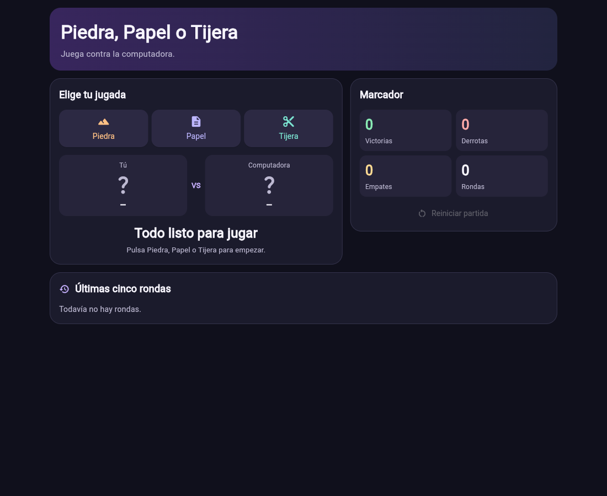
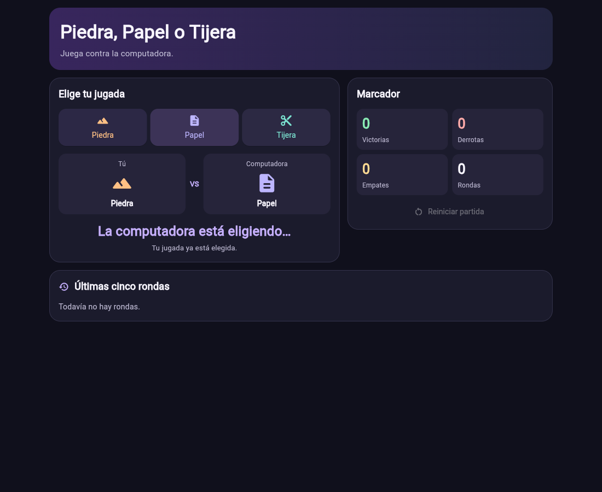
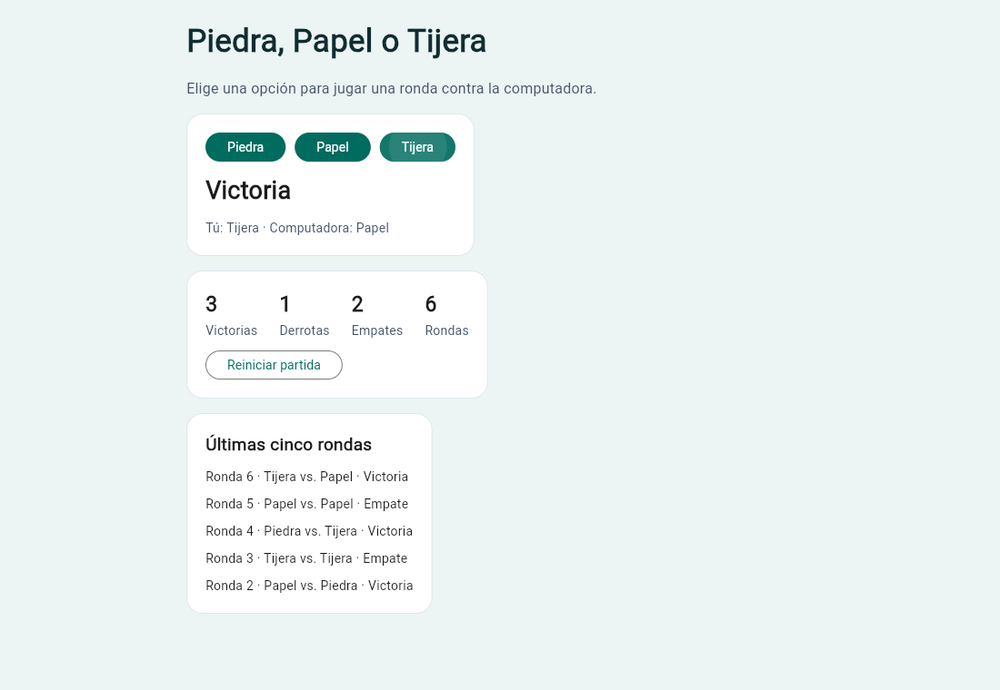
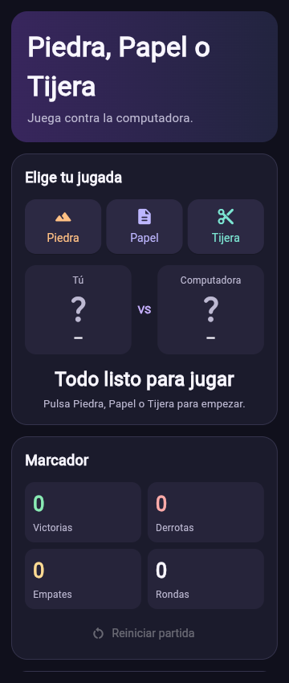

# Piedra, Papel o Tijera — Juego interactivo en Python

**Estudiante:** ______________________________

Una aplicación en la que una persona juega contra la computadora. El desafío consiste en aplicar las tres reglas de victoria, conservar el estado de la partida y presentar los resultados en una interfaz que se pueda usar desde el navegador.

## Objetivos

**Objetivo general.** Implementar un juego interactivo que aplique programación orientada a objetos con Python.

**Objetivos específicos**

- Representar a ambos participantes con una abstracción común y dos formas de elegir.
- Validar cada elección y resolver las rondas mediante las reglas tradicionales.
- Mantener estadísticas e historial con datos protegidos por la clase de juego.
- Conectar la interfaz a la partida mediante callbacks y empaquetarla para la web.

## Manual de usuario

1. Abre la aplicación y pulsa **Piedra**, **Papel** o **Tijera**. Tu elección aparece al instante. La computadora muestra una animación breve y luego revela su elección aleatoria y el resultado.
2. Revisa **Victorias**, **Derrotas**, **Empates** y **Rondas**. El historial lista hasta cinco rondas, de la más reciente a la más antigua.
3. Pulsa **Reiniciar partida** para empezar de cero. El marcador vuelve a cero y se limpia el historial.

Piedra vence a tijera, tijera vence a papel y papel vence a piedra. Dos elecciones iguales producen un empate. Los datos se guardan en memoria mientras la página está abierta.

## Tecnologías y requisitos

Python 3.12, Flet 1.1.3, `random` de la biblioteca estándar y pytest. GitHub Actions empaqueta la aplicación estática para GitHub Pages. La compilación web ejecuta Python en el navegador mediante Pyodide.

## Ejecutar en el navegador desde el código

Desde la raíz del proyecto, en un terminal de GitHub Codespaces o en un equipo con Python 3.12:

```bash
python -m venv .venv
source .venv/bin/activate
python -m pip install -r requirements.txt -r requirements-dev.txt "flet-cli==1.1.3"
python -m pytest -q
flet publish main.py --python-version 3.12 --route-url-strategy hash
python -m http.server 8000 --bind 0.0.0.0 --directory dist
```

En un equipo local, abre `http://localhost:8000`. En Codespaces, abre **Ports** y usa **Open in Browser** para el puerto 8000. El terminal y Python se ejecutan en la nube.

Para desplegar en GitHub Pages, un administrador debe seleccionar **GitHub Actions** en **Settings → Pages → Source**. En **Actions**, abre **Publicar en GitHub Pages** y ejecuta **Run workflow** si el primer envío ocurrió antes de habilitar Pages. Los envíos posteriores a `main` lo ejecutan automáticamente.

## Capturas de la actualización

**Pantalla inicial.** Los tres botones tienen iconos y el marcador empieza en cero.



**Durante la animación.** Tu elección ya aparece mientras la computadora alterna los iconos.



**Después de seis rondas.** Se muestran el último resultado, el marcador y las cinco rondas más recientes.



**Vista móvil.** El marcador se coloca debajo de la zona de juego.



## Estructura

| Archivo o carpeta | Contenido |
|---|---|
| `main.py` | Interfaz Flet y punto de entrada |
| `modelos.py` | Participantes, opciones, resultados y rondas |
| `juego.py` | Reglas, marcador, historial y reinicio |
| `requirements.txt`, `requirements-dev.txt` | Dependencias de ejecución y de pruebas |
| `pruebas/test_juego.py` | Pruebas automatizadas |
| `docs/INFORME_TECNICO.md` | Diseño, arquitectura y verificación |
| `docs/GUIA_EXPOSICION.md` | Demostración y guion de cuatro minutos |
| `docs/imagenes/` | Capturas reales de la aplicación |
| `.github/workflows/deploy.yml` | Pruebas y publicación web |

[Informe técnico](docs/INFORME_TECNICO.md) · [Guía de exposición](docs/GUIA_EXPOSICION.md) · [Publicación estática de Flet](https://docs.flet.dev/publish/web/static-website/)
