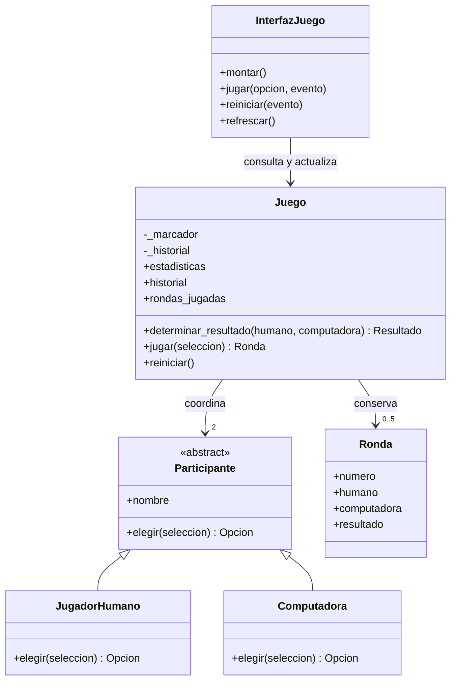

# Informe técnico

## 1. Análisis del problema

Cada ronda requiere dos elecciones válidas y produce uno de tres resultados desde la perspectiva del jugador. El total de rondas debe coincidir con la suma de victorias, derrotas y empates, aunque el historial visible se limite a las cinco rondas más recientes. El reinicio debe descartar el estado y permitir que la próxima ronda vuelva a numerarse desde uno.

## 2. Diseño inicial

Se definió un contrato común para los participantes y un tipo para cada dato de la ronda. La partida crea y coordina los participantes. La interfaz recibe una instancia de la partida y consulta sus datos cuando refresca los controles.

## 3. Arquitectura del software

`modelos.py` define los datos y el comportamiento de los participantes. `juego.py` aplica las reglas y mantiene la partida. `main.py` traduce clics en acciones y convierte el estado en texto visible. Esta dirección de dependencias permite importar y probar `Juego` sin inicializar Flet. La aplicación estática usa el runtime Python de Pyodide en el navegador.

## 4. Aplicación de POO

| Concepto | Clase | Método o atributo | Archivo | Aplicación |
|---|---|---|---|---|
| Clases y objetos | Juego, InterfazJuego | `main()` | `main.py` | Cada sesión instancia una partida y su interfaz. |
| Constructores | Participante, Juego, InterfazJuego | `__init__()` | `modelos.py`, `juego.py`, `main.py` | Inicializan el nombre, el estado y los controles. |
| Atributos y métodos | Juego | `_marcador`, `jugar()` | `juego.py` | El método usa y actualiza el estado de su instancia. |
| Encapsulamiento | Juego | `estadisticas`, `historial` | `juego.py` | Expone una copia del marcador y una tupla de rondas inmutables. |
| Herencia | JugadorHumano, Computadora | `__init__()` heredado | `modelos.py` | Comparten el nombre y el contrato del participante. |
| Polimorfismo | Juego y subclases de Participante | `jugar()`, `elegir()` | `juego.py`, `modelos.py` | Una misma operación valida la entrada humana o sortea la elección según el objeto. |
| Abstracción | Participante | `elegir()` | `modelos.py` | El método abstracto exige una implementación en las subclases concretas. |
| Relaciones entre objetos | Juego, Participante, Ronda e InterfazJuego | `__init__()`, `jugar()` | `juego.py`, `main.py` | La partida coordina sus participantes, registra rondas y se comparte con la interfaz. |
| Programación orientada a eventos | InterfazJuego | `montar()` | `main.py` | Vincula los controles a sus eventos de clic. |
| Callbacks | InterfazJuego | `jugar()`, `reiniciar()` | `main.py` | Flet invoca los métodos registrados; estos cambian la partida y refrescan la pantalla. |

## 5. Construcción de la interfaz

La pantalla usa tres tarjetas para la jugada, el marcador y el historial. Los botones se adaptan al espacio disponible y la página permite desplazarse en pantallas pequeñas. `refrescar()` lee el historial y las estadísticas y actualiza los controles. El botón de reinicio se desactiva mientras no haya rondas.

## 6. Proceso de desarrollo

Primero se implementó el modelo y se comprobó la tabla de reglas. Se usó una subclase con elección fija para probar resultados reproducibles. Después se conectaron los eventos de Flet, se generó una compilación estática y se comprobó su comportamiento desde Chromium.

## 7. Pruebas de funcionamiento

`python -m pytest -q` ejecutó diez casos y los diez pasaron.

| Caso ejecutado | Resultado observado |
|---|---|
| Piedra contra tijera, tijera contra papel y papel contra piedra | Victoria para la primera opción y derrota al invertir cada pareja. |
| Las tres parejas de opciones iguales | Empate en cada caso. |
| Seis rondas ante una computadora con tijera fija | Dos victorias, dos derrotas y dos empates. El historial guarda las rondas 6 a 2. |
| Reinicio después de una jugada | Marcador e historial vacíos. La siguiente ronda empieza en uno. |
| Entrada inválida `Lagarto` | Se genera `ValueError` con un mensaje claro y el estado queda intacto. |
| Edición del diccionario devuelto por `estadisticas` | La edición no altera el marcador interno. |

La verificación de la compilación estática en Chromium incluyó los tres botones, seis rondas consecutivas, el límite del historial y el reinicio. Las capturas del README corresponden a esa ejecución.

## 8. Problemas técnicos y soluciones

1. Flet intentó escribir la caché de compilación en un directorio de solo lectura del entorno. Se estableció `FLET_CACHE_DIR` en una carpeta con permiso de escritura y el empaquetado se completó.
2. En la automatización de Chromium, el control de accesibilidad de Flutter quedó fuera del área visible y el intento de hacer clic falló. El intento con teclado tampoco expuso los controles al script. Se ejecutó la prueba mediante clics en los controles visibles y se verificó el texto renderizado con reconocimiento óptico de caracteres.

## 9. Conclusiones

La partida se puede explicar siguiendo el recorrido desde el botón hasta el objeto `Ronda`. La herencia y el polimorfismo permiten sustituir una computadora aleatoria por una con jugada fija durante las pruebas. La interfaz muestra los resultados de la clase `Juego` a través de sus propiedades.

## 10. Posibles mejoras

Una futura versión podría mostrar el porcentaje de victorias o permitir jugar al mejor de tres. Ambas mejoras se implementarían en el modelo de la partida y se reflejarían en la interfaz.

[Documentación de publicación estática de Flet](https://docs.flet.dev/publish/web/static-website/)
